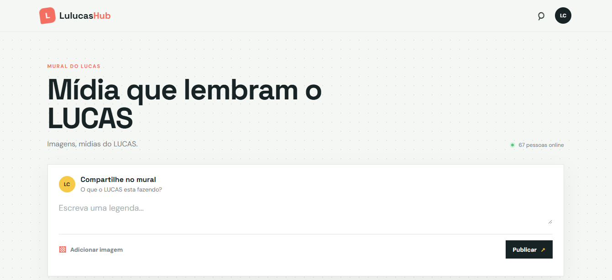
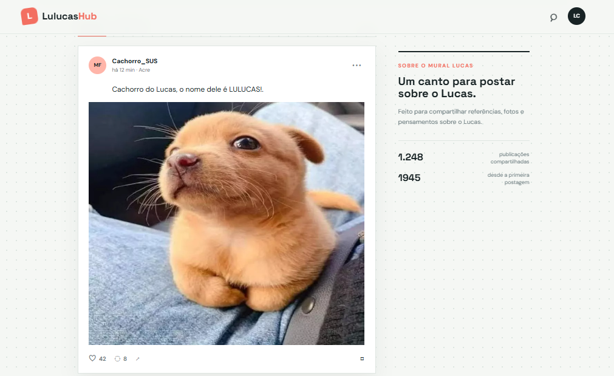
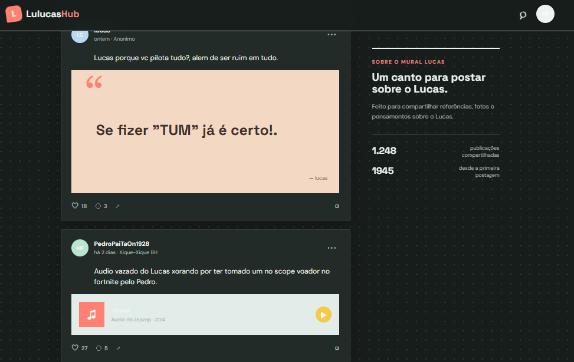
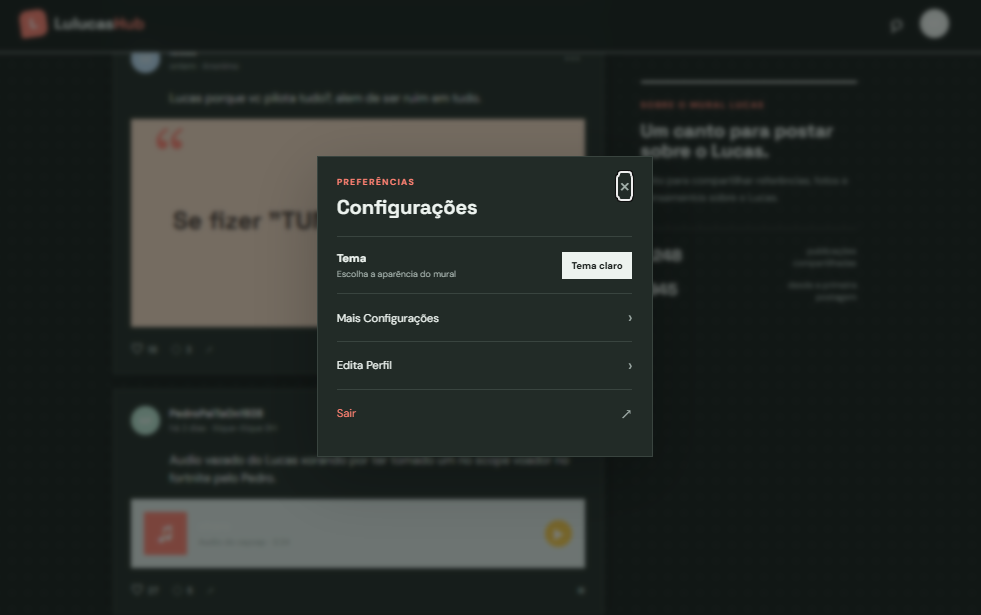

# LulucasHub

Um mural interativo desenvolvido como projeto de **front-end**, utilizando HTML, CSS e JavaScript puro. A proposta é compartilhar publicações com textos e imagens em uma interface inspirada em redes sociais.

🌐 **Acesse a demonstração:** https://capyryanmus.github.io/Site-lulucas/

## Demonstração

### Página inicial


### Publicações no tema claro


### Publicações no tema escuro


### Configurações


## Funcionalidades implementadas

- Criar publicações com texto e imagem.
- Pré-visualizar e remover uma imagem antes de publicar.
- Salvar publicações localmente no navegador usando `localStorage`.
- Restaurar publicações salvas ao abrir o site novamente no mesmo navegador.
- Alternar entre tema claro e escuro, mantendo a preferência localmente.
- Ordenar publicações por recentes ou populares.
- Curtir e salvar publicações durante a sessão.
- Interface responsiva para dispositivos menores.

## Tecnologias

- **HTML5** — estrutura e semântica.
- **CSS3** — layout responsivo, estilos e temas.
- **JavaScript** — manipulação do DOM, eventos e armazenamento local.
- **GitHub Pages** — hospedagem da demonstração.

## Executar localmente

1. Clone o repositório:
   ```bash
   git clone https://github.com/CapyRyanMUs/Site-lulucas.git
   ```
2. Abra a pasta do projeto.
3. Abra o arquivo `index.html` no navegador.

Não é necessário instalar dependências ou configurar um servidor.

## Escopo e limitações

Este projeto é intencionalmente **somente front-end** e não possui backend ou banco de dados remoto.

- As publicações criadas são armazenadas apenas no navegador em que foram feitas.
- Os dados não são sincronizados entre dispositivos ou usuários.
- Curtidas e itens salvos não possuem persistência após recarregar a página.
- Algumas informações e publicações exibidas inicialmente são conteúdo demonstrativo.
- Elementos como comentários, reprodução de áudio e algumas opções de configuração são apenas demonstrativos e não representam funcionalidades completas.

O objetivo do projeto é praticar desenvolvimento de interfaces, responsividade, manipulação do DOM e persistência de dados no próprio navegador.

---

Desenvolvido por [CapyRyanMUs](https://github.com/CapyRyanMUs).
